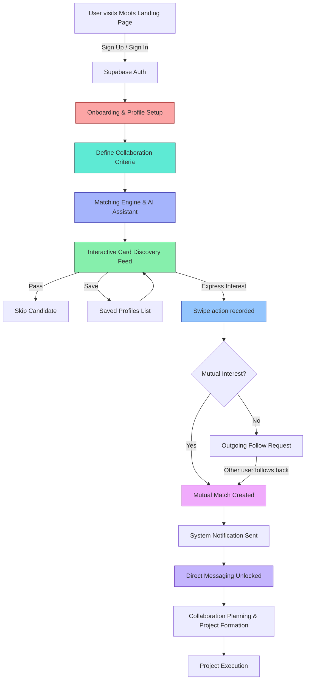

# Moots User Workflow Documentation

> **Moots** is a campus collaboration matching platform designed to help Telkom University students discover compatible partners for projects, competitions, research, startups, and coursework. This document describes the complete end-to-end user journey from first sign-up to active collaboration, mapped directly to the production codebase.

---

## Overview

The platform follows a **skill-based discovery** model: users build a structured profile, define what they are looking for, browse curated candidate cards, express interest, and—when interest is mutual—unlock an instant chat room to plan collaboration. The system is split between a **React + Supabase frontend** (auth, data, real-time chat, notifications) and a **Laravel backend** (AI assistant, legacy REST API, SPA hosting, broadcasting hooks).

---

## Step 1: Onboarding & Structured Profile Setup

### Operational Breakdown

1. The user lands on the [LandingPage](frontend/src/pages/LandingPage.tsx) and clicks **Sign Up** (`/signup`).
2. The frontend calls **Supabase Auth** (`supabase.auth.signUp`) to create an account using email and password.
3. After authentication, the user is guided through a multi-step onboarding flow rendered inside [App.tsx](frontend/src/App.tsx) to capture:
   - Full name
   - Primary **role** (e.g., UI/UX Designer, Backend Developer)
   - **Main skill** and additional skills with proficiency level
   - Short bio and experience summary
   - Campus / faculty / program (default: Telkom University)
   - Availability status
   - Portfolio links
4. The profile is persisted to the Supabase `profiles` table and synchronized with the local application state via the `useSymbio` context.

### Codebase Mapping

| Layer | File / Symbol | Responsibility |
|-------|---------------|----------------|
| Frontend entry | [frontend/src/pages/LandingPage.tsx](frontend/src/pages/LandingPage.tsx) | Marketing site with sign-up CTA |
| Frontend auth client | [frontend/src/lib/supabase.ts](frontend/src/lib/supabase.ts) | Supabase client with custom per-tab session storage |
| Frontend app shell | [frontend/src/App.tsx](frontend/src/App.tsx) | Onboarding wizard, route guards, global state (`useSymbio`) |
| Backend fallback API | [app/Http/Controllers/AuthController.php](app/Http/Controllers/AuthController.php) | `register()` creates `User` and empty `Profile` records |
| Backend fallback API | [app/Http/Controllers/ProfileController.php](app/Http/Controllers/ProfileController.php) | `update()` validates and saves profile fields + skill sync |
| Models | [app/Models/User.php](app/Models/User.php), [app/Models/Profile.php](app/Models/Profile.php) | Eloquent relationships and casts |
| Migration | [database/migrations/2024_01_02_000000_create_mutualizm_tables.php](database/migrations/2024_01_02_000000_create_mutualizm_tables.php) | Schema for `users`, `profiles`, `skills`, `profile_skills` |

### Visual Concept

- **Icon:** `UserPlus` or `GraduationCap` from `lucide-react`.
- **Mockup idea:** A 3-step mobile screen sequence: (1) account creation, (2) role & skill selection, (3) preview profile card.
- **Color accent:** University red / coral to signal identity setup.

---

## Step 2: Collaboration Criteria & Preference Setup

### Operational Breakdown

1. During or immediately after onboarding, the user specifies **collaboration goals** and **preference filters**:
   - What are they looking for? (competition, startup, coursework, research, event)
   - Which roles do they need on their team?
   - Required / desired skills
   - Preferred availability level
   - Program / faculty alignment
2. These values are stored in `looking_for` JSON on the `profiles` table and as typed `FilterValues` in the frontend ([frontend/src/types.ts](frontend/src/types.ts)).
3. The criteria feed both the matching engine and the AI assistant, enabling personalized candidate and project recommendations.

### Codebase Mapping

| Layer | File / Symbol | Responsibility |
|-------|---------------|----------------|
| Frontend types | [frontend/src/types.ts](frontend/src/types.ts) | `FilterValues`, `CandidateProfile`, `lookingFor`, `collaborationGoals` |
| Frontend state | [frontend/src/App.tsx](frontend/src/App.tsx) | Filter state and onboarding data normalization |
| Backend model | [app/Models/Profile.php](app/Models/Profile.php) | `$casts = ['looking_for' => 'array', 'portfolio_links' => 'array']` |
| Backend controller | [app/Http/Controllers/ProfileController.php](app/Http/Controllers/ProfileController.php) | Validates `looking_for` and related preference fields |
| Database | [database/migrations/2024_01_02_000000_create_mutualizm_tables.php](database/migrations/2024_01_02_000000_create_mutualizm_tables.php) | `profiles.looking_for` JSON column |

### Visual Concept

- **Icon:** `SlidersHorizontal` or `Target` from `lucide-react`.
- **Mockup idea:** A filter panel with chips for “Competition”, “Startup”, “Research”, plus skill tags and a slider for availability.
- **Color accent:** Teal to signal tuning / preferences.

---

## Step 3: Matching Engine & Smart Assistant Logic

### Operational Breakdown

1. When the user opens the Discover screen, the frontend requests a curated pool of candidate profiles from Supabase.
2. The candidate pool is filtered to exclude:
   - The user themselves
   - Users already swiped on
   - Users already matched with
   - Users without a profile
3. Optional role, skill, and availability filters are applied from the user’s `FilterValues`.
4. The **AI Assistant** can be invoked at any time to:
   - Recommend candidates based on natural-language prompts
   - Analyze skill fit between the user and a specific candidate
   - Suggest chat openers
   - Answer platform or skill-development questions
5. The assistant prioritizes **Google Gemini** (configurable model), falls back to **OpenRouter**, and finally uses a robust local rule-based fallback.

### Codebase Mapping

| Layer | File / Symbol | Responsibility |
|-------|---------------|----------------|
| Frontend context | [frontend/src/App.tsx](frontend/src/App.tsx) | `fetchDiscoverAndMatches()`, candidate filtering, AI assistant hook |
| Frontend types | [frontend/src/types.ts](frontend/src/types.ts) | `SwipeAction`, `CandidateProfile`, `FilterValues` |
| Backend discover | [app/Http/Controllers/DiscoverController.php](app/Http/Controllers/DiscoverController.php) | `index()` excludes swiped/matched users and applies role/skill/availability filters; returns 20 random candidates |
| Backend AI | [app/Http/Controllers/AiAssistantController.php](app/Http/Controllers/AiAssistantController.php) | `suggest()` orchestrates Gemini → OpenRouter → local fallback; `buildContext()` formats candidate data |
| AI events | [app/Events/NewMatch.php](app/Events/NewMatch.php) | Broadcast event when a mutual match is created |
| Configuration | [config/services.php](config/services.php) | Gemini and OpenRouter credentials / model defaults |
| Environment | [.env.example](.env.example) | `GEMINI_API_KEY`, `GEMINI_MODEL`, `OPENROUTER_API_KEY`, `OPENROUTER_MODEL` |

### Visual Concept

- **Icon:** `Sparkles` or `Brain` from `lucide-react`.
- **Mockup idea:** A split screen: left side shows candidate cards, right side shows the AI assistant chat panel with a glowing “AI suggestion” chip.
- **Color accent:** Indigo / violet to signal intelligence and recommendations.

---

## Step 4: Interactive Card Discovery Feed

### Operational Breakdown

1. The user enters the **Discover** screen and sees a stacked deck of candidate cards.
2. Each card displays:
   - Avatar, name, role, main skill
   - Skill chips
   - Short profile summary
   - Availability badge
   - Program / campus metadata
3. The user interacts with the deck using three primary actions:
   - **Pass** (`X`) — skip the candidate
   - **Save** (bookmark icon) — add to a saved list for later review
   - **Express Interest** (heart / follow icon) — signal desire to collaborate
4. The swipe action is persisted immediately. The frontend updates local state optimistically; the backend records the action in the `swipes` table.

### Codebase Mapping

| Layer | File / Symbol | Responsibility |
|-------|---------------|----------------|
| Frontend deck | [frontend/src/App.tsx](frontend/src/App.tsx) | Card stack component, gesture handling, `actOnCandidate(action)` |
| Frontend landing demo | [frontend/src/pages/LandingPage.tsx](frontend/src/pages/LandingPage.tsx) | `HeroCardDeck()` shows the same visual concept on the landing page |
| Frontend types | [frontend/src/types.ts](frontend/src/types.ts) | `SwipeAction = "pass" \| "interest" \| "save"` |
| Backend API | [app/Http/Controllers/DiscoverController.php](app/Http/Controllers/DiscoverController.php) | `swipe()` validates action and writes to `swipes` table |
| Model | [app/Models/Swipe.php](app/Models/Swipe.php) | Eloquent model for swipe records |
| Database | [database/migrations/2024_01_02_000000_create_mutualizm_tables.php](database/migrations/2024_01_02_000000_create_mutualizm_tables.php) | `swipes` table with unique `(swiper_id, swiped_id)` |

### Visual Concept

- **Icon:** `Layers` or `Heart` from `lucide-react`.
- **Mockup idea:** A mobile-first swipe deck with the top card slightly rotated under the finger, three floating action buttons at the bottom (Pass, Save, Interest).
- **Color accent:** Green for interest, amber for save, gray for pass.

---

## Step 5: Connection Request & Outreach

### Operational Breakdown

1. When the user taps **Interest** on a candidate card, the frontend calls the swipe action endpoint.
2. The system records an `interest` row in the `swipes` table.
3. At this stage:
   - If the other user has **not yet** expressed interest, the candidate appears in the current user’s outgoing “Follow requested” list.
   - The user can optionally open the candidate detail sheet and use the **AI Assistant** to generate a personalized first message or icebreaker.
4. Users can also create or join **Projects** and invite matched collaborators, extending the single-user discovery flow into team formation.

### Codebase Mapping

| Layer | File / Symbol | Responsibility |
|-------|---------------|----------------|
| Frontend matches | [frontend/src/pages/MatchesPage.tsx](frontend/src/pages/MatchesPage.tsx) | Shows pending outgoing / incoming interest requests and accepted matches |
| Frontend detail | [frontend/src/App.tsx](frontend/src/App.tsx) | `CandidateDetailSheet` and AI-assisted message suggestions |
| Backend API | [app/Http/Controllers/DiscoverController.php](app/Http/Controllers/DiscoverController.php) | `swipe()` stores `interest` and checks for mutuality |
| Backend AI | [app/Http/Controllers/AiAssistantController.php](app/Http/Controllers/AiAssistantController.php) | Generates icebreakers and outreach suggestions |
| Backend projects | [app/Http/Controllers/ProjectController.php](app/Http/Controllers/ProjectController.php) | `store()`, `join()` for project-based collaboration |
| Model | [app/Models/Project.php](app/Models/Project.php) | Project metadata, needed roles, skills |

### Visual Concept

- **Icon:** `Send` or `Handshake` from `lucide-react`.
- **Mockup idea:** A candidate profile modal with a prominent “Follow / Express Interest” button and a secondary “Ask AI for opener” button.
- **Color accent:** Soft blue to signal invitation and outreach.

---

## Step 6: Mutual Match & System Notification

### Operational Breakdown

1. When user **A** expresses interest in user **B**, the backend checks whether **B** has already expressed interest in **A**.
2. If mutual interest exists, the system atomically creates a record in the `matches` table (ordered by `min(user_a_id, user_b_id)` to ensure uniqueness).
3. On creation:
   - A `NewMatch` event is broadcast via Laravel’s broadcasting layer.
   - An in-app notification is created for the newly matched partner.
   - Both users receive a real-time alert through Supabase Realtime subscriptions in the frontend.
4. The match appears immediately in both users’ **Matches** screen with a status of `accepted`, unlocking the chat button.

### Codebase Mapping

| Layer | File / Symbol | Responsibility |
|-------|---------------|----------------|
| Frontend matches | [frontend/src/pages/MatchesPage.tsx](frontend/src/pages/MatchesPage.tsx) | Renders accepted matches and incoming/outgoing pending requests |
| Frontend state | [frontend/src/App.tsx](frontend/src/App.tsx) | Subscribes to Supabase Realtime for match and notification changes |
| Backend matching | [app/Http/Controllers/DiscoverController.php](app/Http/Controllers/DiscoverController.php) | Mutual-interest detection and `UserMatch::firstOrCreate()` |
| Backend events | [app/Events/NewMatch.php](app/Events/NewMatch.php) | Broadcast event payload for new matches |
| Backend notifications | [app/Models/AppNotification.php](app/Models/AppNotification.php) | In-app notification record |
| Model | [app/Models/UserMatch.php](app/Models/UserMatch.php) | Eloquent model over the `matches` table |
| Database | [database/migrations/2024_01_02_000000_create_mutualizm_tables.php](database/migrations/2024_01_02_000000_create_mutualizm_tables.php) | `matches` and `notifications` tables |

### Visual Concept

- **Icon:** `Bell` or `Zap` from `lucide-react`.
- **Mockup idea:** A celebratory match screen: “It’s a Moots Match!” with both avatars connected by a glowing line, plus a primary “Start Chat” CTA.
- **Color accent:** Magenta / electric pink to signal excitement and connection.

---

## Step 7: Direct Messaging & Collaboration Initiation

### Operational Breakdown

1. From the **Matches** screen, either user taps the **Chat** button on the accepted match.
2. The frontend navigates to `/chat/:matchId` and opens a real-time messaging room.
3. Messages are loaded from Supabase (or fallback Laravel API) and streamed in real time via Supabase Realtime.
4. Users can:
   - Send text messages
   - Edit their own messages
   - Delete their own messages
   - Mark messages as read
   - Create group chats with multiple matches for team projects
5. The conversation becomes the workspace where collaborators discuss scope, timeline, roles, and next steps. Project owners can later invite matched users into formal `Project` memberships.

### Codebase Mapping

| Layer | File / Symbol | Responsibility |
|-------|---------------|----------------|
| Frontend matches | [frontend/src/pages/MatchesPage.tsx](frontend/src/pages/MatchesPage.tsx) | Chat button navigates to `/chat/${match.id}` |
| Frontend chat | [frontend/src/App.tsx](frontend/src/App.tsx) | Chat room UI, message list, input, realtime subscription |
| Backend API | [app/Http/Controllers/ChatController.php](app/Http/Controllers/ChatController.php) | `messages()`, `send()`, `update()`, `destroy()` with participant authorization |
| Backend API | [app/Http/Controllers/MatchController.php](app/Http/Controllers/MatchController.php) | `index()` returns matches with partner profile and latest message |
| Backend events | [app/Events/MessageSent.php](app/Events/MessageSent.php) | Broadcasts new messages to the other participant |
| Models | [app/Models/Message.php](app/Models/Message.php), [app/Models/UserMatch.php](app/Models/UserMatch.php) | Message and match relationships |
| Database | [database/migrations/2024_01_02_000000_create_mutualizm_tables.php](database/migrations/2024_01_02_000000_create_mutualizm_tables.php) | `messages` table with `match_id`, `sender_id`, `read_at` |

### Visual Concept

- **Icon:** `MessageCircle` or `MessagesSquare` from `lucide-react`.
- **Mockup idea:** A clean chat interface with the partner’s avatar at the top, a scrollable message bubble list, and a bottom input bar. Optional side panel shows shared skills and suggested AI icebreaker.
- **Color accent:** Brand purple / lavender to signal communication.

---

## End-to-End User Flow Diagram

---

## Summary Table

| Step | User Action | Backend / Data Process | Key Files |
|------|-------------|------------------------|-----------|
| 1 | Sign up & build profile | Supabase Auth + `profiles` insert/update | [frontend/src/lib/supabase.ts](frontend/src/lib/supabase.ts), [app/Http/Controllers/AuthController.php](app/Http/Controllers/AuthController.php), [app/Http/Controllers/ProfileController.php](app/Http/Controllers/ProfileController.php) |
| 2 | Set collaboration goals & filters | `looking_for` JSON saved to `profiles` | [frontend/src/types.ts](frontend/src/types.ts), [app/Models/Profile.php](app/Models/Profile.php) |
| 3 | Open Discover / ask AI | Candidate filtering + Gemini/OpenRouter/local AI | [app/Http/Controllers/DiscoverController.php](app/Http/Controllers/DiscoverController.php), [app/Http/Controllers/AiAssistantController.php](app/Http/Controllers/AiAssistantController.php) |
| 4 | Browse & swipe cards | `swipes` table records pass/save/interest | [frontend/src/App.tsx](frontend/src/App.tsx), [app/Models/Swipe.php](app/Models/Swipe.php) |
| 5 | Send connection interest | `swipes.action = 'interest'` persisted | [app/Http/Controllers/DiscoverController.php](app/Http/Controllers/DiscoverController.php) |
| 6 | Mutual match triggers notification | `matches` row created; `NewMatch` event + notification | [app/Models/UserMatch.php](app/Models/UserMatch.php), [app/Events/NewMatch.php](app/Events/NewMatch.php), [app/Models/AppNotification.php](app/Models/AppNotification.php) |
| 7 | Chat & plan collaboration | Real-time messages via Supabase Realtime / Laravel broadcast | [frontend/src/pages/MatchesPage.tsx](frontend/src/pages/MatchesPage.tsx), [app/Http/Controllers/ChatController.php](app/Http/Controllers/ChatController.php), [app/Models/Message.php](app/Models/Message.php) |

---

*Document generated for the Moots project. All frontend routes, controller methods, and database models referenced above exist in the current repository.*
